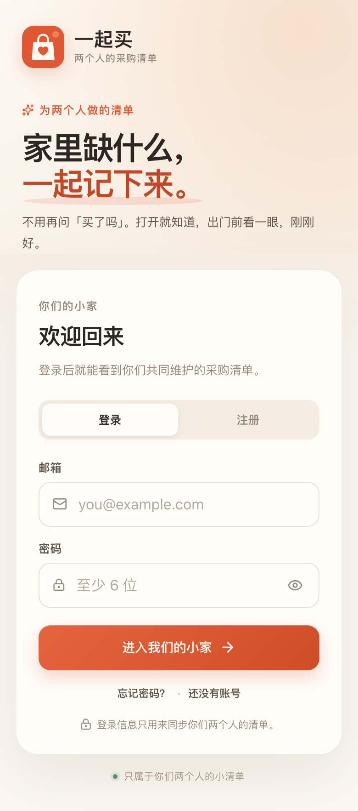
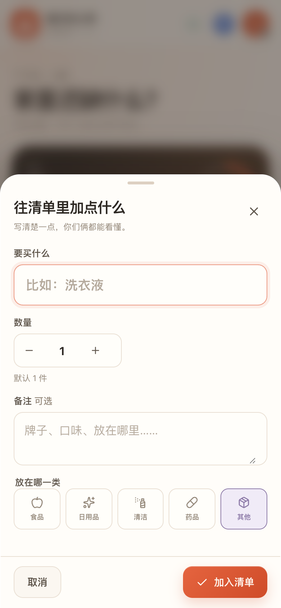
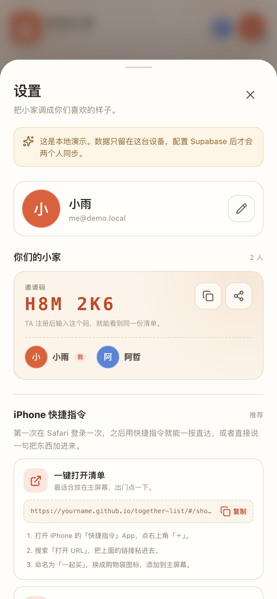
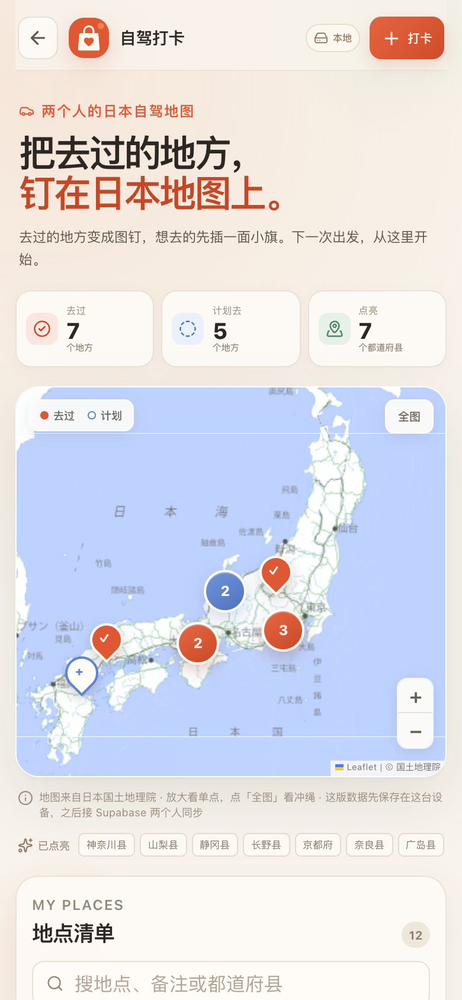
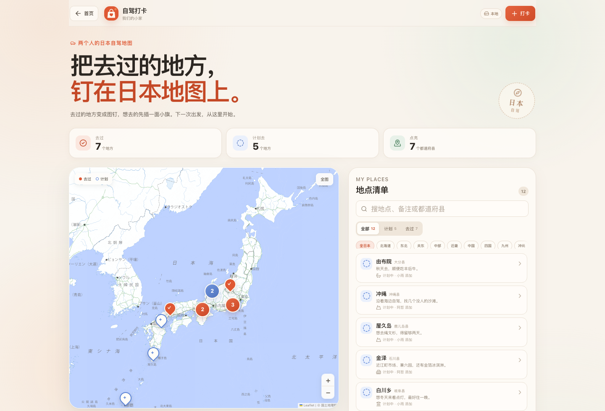

# 小家控

> 两个人的小家。一起买，也一起去。

<p align="center">
  
</p>

<p align="center">
  
  
  
</p>

<p align="center">
  
</p>

> 截图里的昵称、地点和物品是界面示意；线上演示模式默认是空数据，不会预置任何内容。

## 这是什么

一个只属于你们两个人的小网站。登录后先看到两个入口：

- **自驾打卡**：去过的地方钉在日本地图上，计划去的地方先插一面小旗。
- **一起买**：两个人共享的采购清单，谁加了什么、谁买好了都看得见。

再具体一点：

- **两个人共用一份清单**：你加洗发水，TA 加洗衣液，打开都是同一份。
- **不同设备都能登录**：iPhone、iPad、电脑都可以，数据实时同步。
- **名字随时能改**：设置里点名字旁边的铅笔；对方会同步看到新名字。
- **谁加的、什么时候加的**：清单里会留下名字和时间，不用再问「买了吗」。
- **买完勾一下**：已买的东西会收进底部，随时可以放回待买。
- **分类、搜索、备注、数量**：洗发水放日用品，牛奶放食品，找起来很快。
- **可以添加到主屏幕**：像一个 App 一样使用。
- **支持 iOS 快捷指令**：一按打开清单，或者说一句「家里缺牛奶」就加进去。

## 自驾打卡

首页第一张卡片就是「自驾打卡」。点进去是一张属于你们两个人的日本地图。



<p align="center">
  
</p>

- 入口：首页的「自驾打卡」卡片，或直接访问 `/#/roadtrip`
- 日本地图：Leaflet + 日本国土地理院淡色地图，不需要 API key
- 去过的地方用珊瑚色图钉，计划去的地方用蓝色图钉
- 支持地图聚合、放大地图看单个图钉、「全图」查看冲绳
- 内置 100+ 个日本常见自驾地点，支持中文 / 日文搜索
- 搜不到的地点可以点「在日本地图上搜索」，通过 OpenStreetMap 在线补全（需要联网）
- 也可以直接在地图上点选自定义位置
- 计划 ↔ 去过随时切换，记录日期、评分、备注
- 自动统计去过的都道府县
- 没配置 Supabase 时，数据保存在浏览器 localStorage；配置后会写入 Supabase，两个人实时同步
- 从「购物清单」点左上角的小家名字，可以回到首页

首页在手机上是两张上下排列的大卡片，在电脑上是左右两栏；地图页手机单列、电脑地图 + 列表双栏。

## 为什么 GitHub 之外还需要 Supabase

GitHub Pages 只能托管**静态网页**，它没有数据库，也没有登录能力。两个人要看到同一份清单、同一张地图，数据必须存在一个双方都能访问的地方。

所以这个项目是：

```
GitHub Pages（网页）  ──登录、读写──>  Supabase（数据库 + 账号）
        ↑                                      ↑
   你们打开的页面                        免费、无需服务器
```

- 网页和代码放在 GitHub，用 GitHub Actions 自动部署。
- 数据放在 Supabase 免费版，不需要自己买服务器。
- 前端只使用 Supabase 的 **anon public key**，安全性由数据库的 RLS（行级安全）保证。
- 只有同一个「小家」的成员能读写里面的清单和地图。

> 不想配置也能先看：没有填 Supabase 环境变量时，项目会自动进入**本地演示模式**，数据只存在浏览器里，适合预览界面。

---

## 本地先跑起来（可选）

需要 Node.js 22.12 或更高版本。

```bash
npm install
npm run dev
```

打开 `http://localhost:5173`，会看到演示模式。点「以小雨进入」或「以阿哲进入」就能体验完整界面。

演示模式的数据保存在浏览器 `localStorage`，换设备不会同步。

---

## 正式部署（大约 15 分钟）

### 0. 准备

- 一个 GitHub 账号
- 一个 Supabase 账号（免费）
- 这个项目已经下载到本地

### 1. 创建 Supabase 项目

1. 打开 [supabase.com](https://supabase.com)，登录后点 **New project**。
2. 名字随意，比如 `together-list`。
3. 数据库密码自己保存好（这个密码不是登录网站的密码，是数据库密码）。
4. Region 选离你们近的，比如 Tokyo / Singapore / Seoul。
5. 创建后等一两分钟，项目就绪。

### 2. 初始化数据库

1. 进入 Supabase 项目，左侧点 **SQL Editor**。
2. 新建查询，把 [`supabase/schema.sql`](supabase/schema.sql) 整个文件复制进去。
3. 点 **Run**。

脚本会自动创建：

- `profiles`：两个人的昵称和头像颜色
- `households`：小家
- `household_members`：谁属于哪个小家
- `items`：清单内容
- `roadtrip_places`：自驾地图上的去过 / 计划地点
- 行级安全策略（RLS）
- 创建 / 加入小家的函数
- 自动记录「谁添加、谁买好」的触发器
- Realtime 同步所需的配置

脚本可以重复运行，不会重复创建表。

> 如果你之前已经部署过购物清单，**再运行一次完整的 `schema.sql` 即可**新增 `roadtrip_places`，不会删除已有的清单数据。

### 3. 配置登录

进入 **Authentication → Sign In / Providers → Email**。

- 想快速开始：关闭 **Confirm email**。注册后直接进入，不用收邮件。
- 想更稳妥：保留 **Confirm email**。注册后去邮箱点确认链接，再回来登录。

如果保留邮箱确认，建议把邮件模板里的 `{{ .ConfirmationURL }}` 保持默认，不需要改。

然后进入 **Authentication → URL Configuration**：

**Site URL**

```
https://<你的 GitHub 用户名>.github.io/<仓库名>/
```

**Redirect URLs** 添加：

```
https://<你的 GitHub 用户名>.github.io/<仓库名>/
http://localhost:5173/
```

⚠️ 注意最后有 `/`。如果仓库叫 `together-list`，就是：

```
https://yourname.github.io/together-list/
```

### 4. 拿到 Supabase 的两个值

进入 **Project Settings → API / API Keys**：

- **Project URL**，形如 `https://abcdefgh.supabase.co`
- **anon public** key（新版界面可能叫 **Publishable key**）

把本地 `.env.example` 复制成 `.env`：

```bash
cp .env.example .env
```

填入：

```dotenv
VITE_SUPABASE_URL=https://你的项目.supabase.co
VITE_SUPABASE_ANON_KEY=你的 anon public key
```

重新运行：

```bash
npm run dev
```

这时打开的就是真实的登录页，不再是演示模式。

> `anon public` key 本来就是给浏览器用的，可以公开；真正保护数据的是 RLS。**千万不要**把 `service_role` key 放进前端或 GitHub。

### 5. 部署到 GitHub Pages

1. 在 GitHub 新建一个仓库，比如 `together-list`。
2. 把本地代码推上去：

```bash
git init
git add .
git commit -m "一起买：两个人的采购清单"
git branch -M main
git remote add origin https://github.com/<你的用户名>/together-list.git
git push -u origin main
```

3. 打开仓库的 **Settings → Pages**。
4. 在 **Build and deployment → Source** 里选择 **GitHub Actions**。
5. 打开 **Settings → Secrets and variables → Actions**，添加两个 **Repository secrets**：

| Name | Value |
| --- | --- |
| `VITE_SUPABASE_URL` | 你的 Project URL |
| `VITE_SUPABASE_ANON_KEY` | 你的 anon public key |

6. 回到 **Actions** 页面，应该能看到 `Deploy to GitHub Pages` 在运行。等它变绿。
7. 打开：

```
https://<你的用户名>.github.io/<仓库名>/
```

如果页面显示「本地演示模式」，说明 Secrets 没生效或构建时没拿到。检查 Actions 的构建日志，重新运行一次 workflow。

> 仓库名是 `<你的用户名>.github.io` 时，网站会在根域名下，workflow 会自动处理。使用自定义域名时，在仓库 **Variables** 里添加 `VITE_BASE_PATH`，值为 `/`。

### 6. 两个人开始用

**你（第一个用户）**

1. 打开网站，点「注册」。
2. 填名字、邮箱、密码。
3. 登录后进入「创建小家」：给小家起名字，填你的名字。
4. 创建完成后，进入设置，能看到一个 6 位邀请码。

**TA（第二个用户）**

1. 打开同一个网址，注册自己的账号。
2. 登录后选「加入小家」。
3. 输入你发过去的 6 位邀请码和 TA 的名字。
4. 加入后，你们看到的是同一份清单。

之后谁添加、谁勾选，另一台设备会实时同步；即使 Realtime 暂时不可用，也会每 45 秒自动刷新一次。

---

## iPhone 快捷指令

登录一次之后，Safari 会记住登录状态。快捷指令可以打开你们的小家首页，也可以直接进入购物清单。

### 一键打开清单

1. 先用 Safari 打开网站并登录一次。
2. 打开「快捷指令」App，点右上角 **＋**。
3. 搜索并添加 **打开 URL**，填入你的网站地址，例如：

   ```
   https://yourname.github.io/together-list/#/shopping
   ```

4. 把快捷指令命名为「小家控」，选一个购物袋图标。
5. 添加到主屏幕，之后对 Siri 说「小家控」就能打开。

### 添加到主屏幕（推荐）

在 Safari 打开网站：

1. 点底部的 **分享** 按钮。
2. 选择 **添加到主屏幕**。
3. 命名为「小家控」。

之后它就像一个独立 App，打开就是你们的小家首页，再点「一起买」进入清单。

> 主屏幕 App 和 Safari 的登录状态是分开的。第一次从主屏幕打开时，需要再登录一次；之后会记住。

### 说一句就加进清单

这个快捷指令会直接调用网页的「快速添加」参数：

```
https://yourname.github.io/together-list/?add=牛奶&quick=1#/shopping
```

- `add=牛奶`：要添加的内容
- `quick=1`：打开后直接加入，不弹表单
- 不带 `quick=1`：打开添加表单并预填，适合想补数量或备注时

在「快捷指令」里可以这样做：

1. 新建快捷指令。
2. 添加 **询问输入**，类型选「文本」，提示写「要买什么？」。
3. 添加 **URL 编码**，输入选「提供的输入」。
4. 添加 **文本**，内容写：

   ```
   https://yourname.github.io/together-list/?add=
   ```

   然后在后面插入上一步「URL 编码」的变量，最后加上：

   ```
   &quick=1#/shopping
   ```

5. 添加 **打开 URL**，选择上一步的文本。
6. 命名为「家里缺什么」，之后对 Siri 说「家里缺什么」即可。

设置页里也有同样的说明和可复制的链接（「设置 → iPhone 快捷指令」）。

> 快捷指令依赖 Safari 的登录状态。如果很久没打开，或者清理过 Safari 数据，可能需要重新登录一次。

---

## 数据和隐私

- 清单和自驾地图数据存在你自己的 Supabase 项目里，不在第三方广告平台。
- 前端只带 anon key；所有表都开启了 RLS。
- 只有 `household_members` 里的成员才能读取对应小家的清单和地图。
- 邀请码是加入小家的唯一凭证，只发给 TA，不要发到群里。
- 密码由 Supabase Auth 管理，项目代码不接触明文密码。
- 不要提交 `.env`，也不要把 `service_role` key 放进任何前端代码。

### 如果邀请码泄露

当前版本没有「一键换邀请码」的界面。可以在 Supabase SQL Editor 里执行：

```sql
update public.households
set invite_code = upper(substr(md5(random()::text), 1, 6))
where id = '你的 household id';
```

或者直接删掉这个小家重新创建（会丢掉清单）。

---

## 常见问题

**登录提示「邮箱还没验证」**

去注册邮箱点确认链接。或者在 Supabase 的 Authentication → Sign In / Providers → Email 里关闭 **Confirm email**，再重新注册。

**刚运行完 SQL，提示找不到某个函数**

Supabase 的 API 缓存有时需要几秒钟刷新。等 10 秒，或者在 **Project Settings → API** 里点一下刷新/重新加载 schema，再试一次。

**两台手机看不到同一份清单**

- 确认两个账号加入的是同一个小家（设置里的邀请码是否一致）。
- 确认两边的网址是同一个 GitHub Pages 地址。
- 检查 Supabase 项目是否处于 paused 状态，免费项目长时间不用会被暂停。
- 应用每 45 秒会轮询一次；手动点顶部的「已同步」也能立即刷新。

**自驾页面打不开，提示找不到 `roadtrip_places`**

说明 Supabase 还没有升级到新版表结构。重新打开 SQL Editor，把最新的 [`supabase/schema.sql`](supabase/schema.sql) 再运行一次即可，购物清单不会被清空。

**GitHub Pages 白屏 / 404**

- 确认 Settings → Pages → Source 是 **GitHub Actions**。
- 确认 Actions 里的 `Deploy to GitHub Pages` 成功。
- 确认 `VITE_SUPABASE_URL` 和 `VITE_SUPABASE_ANON_KEY` 两个 Secrets 都存在。
- 如果改过仓库名，重新运行 workflow；Supabase 的 Redirect URL 也要同步修改。
- 如果使用自定义域名，检查仓库变量 `VITE_BASE_PATH` 是否为 `/`。

**页面一直是旧版本**

这是一个 PWA，会缓存页面。下拉刷新，或者关掉页面重新打开。重新部署后，Service Worker 会在下次打开时自动更新。

**Supabase 免费项目被暂停**

登录 Supabase 控制台，点 **Restore project**。恢复后数据还在。

**忘记密码**

登录页点「忘记密码」，输入邮箱，打开邮件里的链接，会进入设置新密码的页面。邮件链接必须在同一台设备/浏览器打开。

---

## 开发

```bash
npm run dev        # 本地开发（没有 .env 时自动进入演示模式）
npm run typecheck  # TypeScript 检查
npm test           # 工具函数单元测试
npm run build      # 生产构建
npm run preview    # 预览构建结果
npm run icons      # 重新生成 PWA 图标
```

### 目录

```
.
├── .github/workflows/deploy.yml   # GitHub Pages 自动部署
├── public/                        # 图标、favicon、.nojekyll
├── scripts/make-icons.mjs         # 从 SVG 生成 PNG 图标
├── src/
│   ├── components/                # 首页 Hub、清单、登录、设置等组件
│   ├── context/                   # 登录 / 清单 / Toast 状态
│   ├── lib/
│   │   ├── backend.ts             # Supabase 数据访问
│   │   ├── demo.ts                # 本地演示后端
│   │   ├── supabase.ts            # Supabase 客户端
│   │   └── utils.ts               # 时间、分类、深链等工具
│   ├── roadtrip/                  # 自驾打卡：地图、日本地点库、seed
│   ├── App.tsx
│   └── styles.css
├── supabase/schema.sql            # 数据库、RLS、RPC、Realtime
└── vite.config.ts
```

### 技术栈

- React 19 + TypeScript + Vite
- Supabase（Postgres + Auth + Realtime）
- Leaflet + 日本国土地理院地图瓦片
- 原生 CSS（没有 UI 框架，方便改）
- Vite PWA（可安装、可离线打开）
- GitHub Pages + GitHub Actions

---

## 可以怎么改

- **改名字**：`index.html`、`vite.config.ts` 里的 manifest、`src/components/Logo.tsx`。
- **改配色**：`src/styles.css` 顶部 `:root` 里的 CSS 变量。
- **改分类**：`src/types.ts` 的 `CATEGORIES`，以及 `src/lib/utils.ts` 的关键词猜测。
- **改图标**：替换 `public/favicon.svg`，运行 `npm run icons`。

---

## 最后

这个项目的目标不是做一个功能很多的工具，而是让「家里缺什么」这件事，在你们两个人之间变得简单一点。

如果哪天想加「谁负责买」「预算」「常买清单」之类的功能，现在的数据结构都留了空间。

祝你们每次出门都买齐。 🧺
